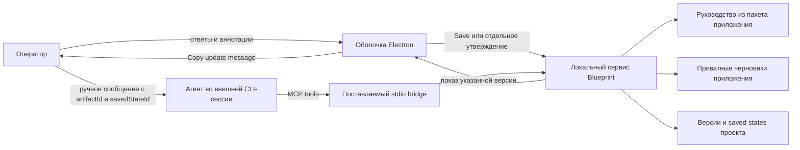

# Blueprint — требования к локальному приложению для планирования и обратной связи

Версия документа: 1.3. Дата: 11 октября 2026 года. Область: локальный продукт для macOS и Codex CLI; текущий этап — сохранённые состояния, аннотации, браузер, сессии Codex и терминальные рабочие пространства. Будущие расширения обозначены отдельно.

Это самостоятельная спецификация нового приложения. Формулировки «должен» и «нельзя» задают обязательное поведение. Инженерные решения первой версии также зафиксированы здесь; они не являются утверждением о наличии работающей реализации. Состояние технической проверки приведено в разделе 19. Нормативные требования не означают, что реализация или испытания уже завершены.

## 1. Проблема и назначение

При планировании работы с агентом оператору приходится читать длинные последовательные ответы, удерживать связи между решениями и вручную объяснять, к какому месту относится замечание. Часть требований остаётся только в истории разговора. Интерактивная визуализация может иметь собственное состояние, но агент не получает автоматически результат взаимодействия оператора с ней.

Blueprint предоставляет локальную среду, в которой агент публикует самостоятельный план, а оператор изучает его через текст, схемы, таблицы и виджеты. Ответы, комментарии и выбранные состояния становятся адресуемым, версионированным контекстом для продолжения той же внешней сессии.

**PROD-01.** Основной сценарий — подготовка и визуальное согласование плана. Интерактивное прототипирование является дополнительным способом снять неопределённость в поведении системы. Создание исполняемого прототипа не обязательно для использования Blueprint.

**PROD-02.** Приложение является бесплатным проектом с открытым исходным кодом, без платных возможностей, обязательной учётной записи продукта или облачного backend. Первая платформа — macOS; стек — Electron и TypeScript; первый поддерживаемый харнесс — Codex CLI. Поддержка других харнессов добавляется через адаптеры без изменения предметной модели артефактов.

**PROD-03.** Blueprint не заменяет пользовательские инструкции и контракты проекта. Для сложных задач контракты в репозитории остаются обязательными по правилам проекта. Утверждённый Blueprint дополняет их основаниями решений, вариантами и примерами и является поводом проверить их согласованность. Расхождение требует явного согласования и обновления соответствующего документа; приложение не выбирает победителя по дате изменения.

### 1.1. Участники

| Участник | Ответственность |
| --- | --- |
| Оператор | Выбирает проект, отвечает, аннотирует, явно сохраняет состояние, вручную сообщает агенту и отдельно утверждает версию |
| Агент во внешнем харнессе | Создаёт артефакт с originSession, готовит исходники и семантику, читает saved state, уточняет план и сверяет контракты |
| Приложение и его MCP-сервер | Хранят данные, показывают материалы, проверяют операции, фиксируют версии и saved states; предоставляют сообщение для ручного копирования |
| Адаптер Codex | Читает метаданные локальных сессий, явно запускает собственный backend/TUI или Resume; чужой терминал и автоматическую доставку не контролирует |

### 1.2. Критерий полезности

Оператор должен иметь возможность согласовать содержательный план без копирования фрагментов в чат и без восстановления связей по памяти. Агент должен получить конкретные замечания с исходным контекстом и версией. Для прототипа оператор должен сохранить и отправить несколько различных случаев, сохранив возможность открыть каждый после перезапуска приложения.

## 2. Объём первой версии

**SCOPE-01.** В текущий этап входят проекты-папки, локальные сессии Codex CLI, терминалы и рабочие пространства с вкладками/split, настройки, MDX Blueprint-документы и draft preview, встроенные виджеты, точные текстовые и прямоугольные аннотации, браузерные вкладки, приватное автосохранение, неизменяемые saved states и отдельное утверждение. Основной цикл: агент создаёт артефакт → оператор отвечает и аннотирует → Save фиксирует состояние → оператор сообщает агенту об обновлении → агент читает снимок и публикует новую ревизию.

Целевые следующие этапы: собственный просмотр и аннотирование истории чата и других файлов, самостоятельные TSX-прототипы и сохранённые случаи. Автоматическая доставка требует отдельного решения и интеграционной приёмки. Требования этих расширений сохранены ниже с явной пометкой; они не блокируют выпуск текущего этапа.

Не входят: собственный агентный координатор или чат, автоматическая доставка, управление worktree, вызовы моделей вне явно запущенного оператором CLI, автоматический запуск или возобновление чужих сессий, browser-use для агента, PDF, синхронная многопользовательская работа, удалённые машины, синхронизация через облако, публичный хостинг и автоматическое доказательство корректности алгоритма.

**SCOPE-02.** Оператор не редактирует текст и исходники артефакта непосредственно. Он изменяет разрешённые значения виджетов и добавляет обратную связь. Источники изменяет агент либо разработчик обычными файловыми средствами, после чего создаётся новая опубликованная версия.

В интерфейсе по умолчанию используются английские подписи; содержание планов и комментариев остаётся на языке автора. Русский язык этого PRD не устанавливает язык интерфейса продукта.

## 3. Выбор формы планирования

**PLAN-01.** Руководство агента использует следующие правила выбора формы. Они являются рекомендациями по работе с системой, а не принудительным глобальным режимом агента.

| Потребность | Подходящее представление |
| --- | --- |
| Короткое линейное требование | Текст, включая обычный ответ в чате |
| Структура, зависимости, покрытие, сравнение | Таблица или схема в Blueprint |
| Выбор варианта, раскрытие последствий, ответы оператора | Интерактивный виджет |
| Существенная неопределённость динамики, случайности или пограничного поведения | Дополнительный исполняемый прототип |

Blueprint уместен для взаимосвязанных решений, существенных неизвестных и пространственного представления. Навязчивое предложение артефакта для каждого небольшого запроса не требуется.

**PLAN-02.** План должен быть самостоятельным: цель, текущие условия, границы и исключения, требования, существенные ограничения, выбранные решения и основания, открытые вопросы, критерии приёмки и связь с контрактами присутствуют внутри документа. Ранее упомянутый в чате факт не может быть единственным местом хранения существенного условия. Свёрнутые подробности остаются в артефакте и доступны агенту как текст или структурированные данные.

Визуализация сопровождается семантическим описанием объектов, связей, единиц и значений. Цвет, координаты и код отрисовки не являются единственным носителем требований.

### 3.1. Основные сценарии планирования

| Сценарий | Действие оператора | Результат согласования |
| --- | --- | --- |
| Границы изменения | Рассмотреть карту компонентов и прокомментировать участок | Включённые и исключённые части, затрагиваемые зависимости |
| Роли и права | Рассмотреть матрицу и отметить конкретную ячейку | Разрешения, запреты и условия доступа |
| Пользовательский путь | Пройти схему экранов, отказов и отмен | Обязательные состояния и переходы |
| Изменение данных или интерфейса | Сравнить текущее и предполагаемое представление | Обязательства совместимости и сохранения данных |
| Варианты реализации | Выбрать вариант и указать основания | Решение с ограничениями, а не только название варианта |
| Поэтапное внедрение | Рассмотреть зависимости и условия этапов | Допустимые промежуточные состояния и условия переходов |

Рабочая последовательность: требования → Blueprint → согласование → сверка контрактов → реализация по правилам проекта, включая TDD. При необходимости исследовательский цикл «прототип → случаи → уточнение» возвращает результаты в план и контракты. Сам прототип не становится независимым оракулом правильности.

## 4. Проекты, сессии и организация интерфейса

**CTX-01.** Проект соответствует выбранной оператором папке. Приложение хранит устойчивый `projectId`, канонический локальный путь и отображаемое имя. Разные checkout и worktree — разные проекты, даже при одинаковом Git remote. Повторный выбор той же канонической папки открывает существующий проект. Git не обязателен.

Переименование или перемещение папки восстанавливается явным выбором нового расположения. Если два одновременно открытых каталога содержат копию одного projectId, приложение требует выбрать оригинал либо создать новую идентичность копии; молча объединять их нельзя. Создание новой идентичности копии означает новый пустой проект: скопированная `.blueprint` предварительно переносится в уникальный резервный каталог, история и приватная работа оригинала не импортируются. Удаление из списка не удаляет файлы.

**CTX-02.** Агент передаёт `originSession` при создании артефакта: в текущей интеграции `{harness:"codex",sessionId}`. Название, MCP `clientInfo` и последняя активность не устанавливают ID сессии. Если агент его не знает, он уточняет ID у пользователя. Предварительная привязка сессии к проекту не требуется. Два артефакта одного проекта могут принадлежать разным сессиям. В будущих адаптерах адрес может включать adapter/endpoint, но недоступность подключения не удаляет сохранённые данные.

**CTX-03.** Связь с сессией хранится у артефакта. Свойства позволяют скопировать ссылку на связанную сессию; это метаданные, а не доказательство доступности харнесса. RECIPIENT SESSION и обязательный получатель проекта отсутствуют. Сохранённое состояние относится к артефакту независимо от того, куда оператор скопировал сообщение. Приложение не меняет сессию по заголовку, активности или клиентскому handshake.

**UI-01.** Интерфейс содержит единое дерево раскрываемых папок проектов с локальными сессиями харнесса и компактной группой Plans, вкладки терминала/документа/стартового экрана/браузера, панель аннотаций и состояние локального сохранения. Длинное название плана сокращается с подсказкой; слева иконка Draft/In review/Approved с текстовым статусом при наведении, приватные изменения обозначаются отдельно. Кнопки Codex в строках планов нет; связь с сессией остаётся метаданными артефакта. Закреплённая вторая панель непосредственно под вкладками объединяет выбор версии и статус; на документной вкладке в ней также Annotate и состояние приватного сохранения. Прокрутка документа не перемещает эту панель. Большую шапку и VISUAL PLANNING не показывать. Верхняя строка высотой 40 px разделена на секции сайдбаров и центральной области по общей сетке колонок; вертикальные разделители и подсветка ресайза совпадают с фактическими границами сайдбаров, включая промежуточные кадры анимации. Вкладки расположены в центральной секции; документная вкладка называется **Plan**, имя плана видно в сайдбаре и не дублируется в шапках. Плюс и переключатели сайдбаров остаются доступны при горизонтальной прокрутке вкладок; выбранная вкладка автоматически видна. Тонкие разделители отделяют группы управления и неактивные вкладки. На браузерной вкладке версия, статус, навигация, адрес, масштаб, внешнее открытие и Annotate собраны в одной строке; адрес занимает свободное место, остальные элементы не растягиваются и не сжимаются. Общая компактная панель окна сохраняет нативные кнопки macOS и область перетаскивания. Переключатели расположены у внутренних границ верхних секций сайдбаров. При скрытии сайдбара его секция исчезает, а переключатель переходит к соответствующему краю центральной секции. При скрытом левом сайдбаре центральная секция резервирует место под нативные кнопки. Оба доступны при скрытых сайдбарах и на стартовом экране; кнопки исключены из области перетаскивания. Они скрывают и возвращают соответствующий сайдбар; видимость и ширина сохраняются в данных приложения, границы нативной браузерной поверхности обновляются при изменении рабочей области. Информационные всплывающие окна без формы и несохранённого ввода закрываются по клику снаружи; клик внутри их не закрывает. Скрытие и раскрытие сайдбаров анимируется за 0,25 с; содержимое сохраняет ширину на время анимации и обрезается границей панели без промежуточного переноса текста; обычное изменение ширины остаётся мгновенным, скрытие и возврат при drag используют ту же анимацию. Ширина левого сайдбара регулируется от 200 до 500 px, правого — от 250 до 500 px, без прилипания; стандартные размеры — 250 px слева и 310 px справа. При drag ниже 140 px слева или 175 px справа сайдбар скрывается; возврат за порог до отпускания мыши раскрывает его. Отпускание закрепляет скрытие, сохраняя прежнюю ширину; Escape отменяет drag. Двойной клик сбрасывает размер; доступны стрелки и Home/End. При нехватке места сайдбары временно уменьшаются, сохраняя предпочтения и центральную область не уже 420 px. Обычные списки, карточки и переключатель версий не показывают UUID; подписи версий — Version 1, Version 2. Save, Copy update message и Approve различимы и имеют разные последствия. Непубликованный артефакт открывается в Draft preview: проверенный MDX без содержательных ответов и редактирования исходника. При отсутствующем файле показывается ожидание, при ошибке — диагностика и исходный текст; preview не публикует документ.

**UI-02.** Каждая сессия имеет собственное рабочее пространство: вкладки, вложенные горизонтальные/вертикальные split, пропорции и активную панель. У проекта без выбранной сессии остаётся самостоятельное пространство Plans. Планы — самостоятельные артефакты проекта, а не дочерние данные сессии. Один документ может быть открыт в нескольких сессиях; ответы и аннотации общие для артефакта, прокрутка и раскладка отдельные для каждого представления. Старые вкладки планов мигрируют без потери приватной работы, версий и снимков.

План по умолчанию открывается справа от активного терминала; настройка позволяет новую вкладку. Уже открытый документ переиспользуется в текущем пространстве. Ручной Split right/down создаёт shell с cwd исходного терминала либо проекта, если исходная панель не терминальная. Терминалы расположены в основной полосе рядом с документами и браузером. Полоса компактная, с иконками, сокращёнными названиями, активным состоянием, крестиками, плюсом и горизонтальной прокруткой. New tab артефакта содержит сфокусированное поле HTTP(S) URL; отправка превращает её в браузер. После закрытия последней вкладки доступны Open plan/New tab и создание терминала. Запрос агента показать версию обновляет целевой документ, не перехватывая проект, сессию, активную панель или ввод оператора; новая вкладка открывается в фоне. Операторское открытие может активировать её.

Если в обновляемом артефакте создаётся выделение, редактируется комментарий или фиксируется снимок, новая версия подготавливается, а переключение откладывается до сохранения текущего действия. Ошибка сохранения блокирует переключение и показывается явно. В обычном режиме активная вкладка обновляется после успешной подготовки версии; старая остаётся доступной.

**UI-03.** Переключение вкладки или плана сначала завершает непустой комментарий либо отменяет пустой и ждёт локальные записи. Крестик и middle-click используют эту же последовательность, затем проверяют внешнюю страницу и закрывают вкладку. Приватная работа Blueprint не теряется и не требует подтверждения после успешного автосохранения; закрытие не выполняет Save, не публикует данные, не удаляет артефакт и не разрешает реализацию. Ошибка записи оставляет редактор открытым, блокирует переход и предлагает Retry/Cancel. Одновременные запросы завершения ожидают одну операцию.

**UI-04.** Нижняя панель содержит общие терминалы проекта, независимые от сессии харнесса. Её вкладки, выбранный терминал, высота и видимость сохраняются локально. Переключатель доступен в интерфейсе, сочетание по умолчанию — ⌘J. Закрытие терминальной вкладки или split-панели убирает представление, сохраняя процесс в фоне; список терминалов проекта позволяет открыть его снова. Отдельное Stop требует подтверждения. Браузерные native views ограничены фактической геометрией каждой видимой панели; только активный браузер владеет аннотационным overlay/маркерами. Фокус из фоновой страницы проходит через ту же безопасную смену панели и завершение комментария.

При открытом редакторе первый клик по соседней браузерной панели завершает комментарий и запрашивает смену панели, но не передаётся сайту. Ошибка записи сохраняет редактор и прежнюю панель; сайт не получает действие или фокус. После успешного перехода оператор может кликнуть снова. Отложенного воспроизведения клика нет.

**SETT-01.** Общая страница настроек открывается по ⌘, и содержит General (план сбоку/вкладкой, восстановление пространства), Terminal (shell/аргументы, шрифт/размер, предел вывода), Harnesses (executable/profile Codex, обнаруженная версия, совместимость и состояние MCP) и Keyboard shortcuts (поиск, переназначение, отключение, сброс, конфликты). Сочетания действуют внутри приложения, включая терминальные и нативные браузерные панели; обычный ввод и IME не перехватываются. По умолчанию назначены ⌘W, Control+Tab/Control+Shift+Tab, ⌘J и ⌘,; split и переходы между панелями изначально не назначены. Настройки и раскладки имеют собственную версию; published documents и saved states не меняются.

## 5. История чата и материалы — следующий этап

**CHAT-01.** Просмотр истории не возобновляет сессию и не отправляет сообщение. Показываются доступные пользовательские и ассистентские сообщения, время и устойчивые идентификаторы. Инструменты и их результаты свёрнуты, раскрываются по требованию и также допускают аннотации. Отсутствующие или недоступные данные обозначаются; скрытые рассуждения агента не восстанавливаются и не запрашиваются.

**CHAT-02.** История обновляется по доступным событиям либо чтением с ограниченным опросом. Обновление не сбрасывает выделение, позицию чтения и незавершённый комментарий. Аннотация потокового сообщения сохраняет снимок выбранного текста и версию прочитанного содержимого. Если источник позже изменился, показывается исходная цитата, а привязка считается устаревшей.

**MAT-01.** Поддерживаются Markdown, HTML, PNG, JPEG, WebP, GIF и веб-страницы. Анимация при создании снимка фиксируется как изображение. Локальный HTML показывается в изолированной поверхности без привилегий приложения; он не получает SDK состояния автоматически. Для обычных материалов гарантируются аннотации и захват видимого контекста, но не восстановление скрытого состояния JavaScript.

Файл вне проекта открывается через явный выбор оператора и имеет отдельное разрешение на чтение. В пакет включается выбранный фрагмент, снимок и необходимая копия источника, а не весь соседний каталог. Изменения исходного файла не переписывают ранее отправленное вложение.

## 6. Предметная модель и идентичность

**DATA-01.** Идентичность и изменяемость разделяются следующим образом.

| Сущность | Существенные поля | Правило изменения |
| --- | --- | --- |
| Project | projectId, path, displayName, storageVersion | Регистрация папки; получатель не определяет проект |
| SessionRef | harness, sessionId | Явная метаинформация артефакта; не presence |
| Artifact | artifactId, projectId, kind, originSession, title, revisions | Метаданные и связи опубликованных версий |
| ArtifactRevision | revisionId, artifactId, sourceDigest, manifest, stateSchema | Неизменяемый документ, определения и ресурсы |
| WorkingState | artifactId, draftVersion, revision-scoped answers, annotations, unfinished composer | Приватное автосохранение локальной работы |
| SavedState | savedStateId, artifactId, stateRevision, document revisions, answers, annotations, attachments, digest, operationId | Неизменяемый полный результат Save |
| Annotation | id, kind, text, annotation, source включая stateContext | Изменяема в работе; каждый снимок содержит её неизменяемую копию |
| CapturedCase — позже | caseId, revisionId, state, inputs, outputs, capture | Неизменяемый случай прототипа |
| Legacy FeedbackPackage | packageId, recipient, items, attachments, digest | Существующий результат Submit остаётся читаемым; не используется для нового Save |
| DeliveryAttempt — позже | attemptId, target, savedStateId, status, receipt | Дописываемая история только после отдельной приёмки доставки |
| Approval | approvalId, revisionId, stateDigest, savedState basis, createdAt | Отдельное решение оператора; новая работа его не наследует |

ID генерирует сервер; они не выводятся из названия, вкладки или позиции текста. Номер аннотации — позиция в массиве конкретного saved state, а не ID сущности. Между снимками сопоставление выполняется по стабильному ID. Время — UTC, интерфейс показывает локальное время.

`guideVersion`, версии документа, saved state, SDK и хранилища обозначают разные контракты. Совпадение версии руководства не доказывает совместимость данных.

Строка проекта содержит **…** и **+**, доступные при наведении и клавиатурном фокусе. **…** и правый клик открывают одно нативное меню New plan, Locate folder только для недоступного проекта, разделитель, Remove from list. Постоянных кнопок под строкой нет; сообщение о недоступности остаётся. Меню закрывается снаружи и Escape. Создание для недоступной папки отключено. **+** сразу создаёт Untitled plan, раскрывает проект и открывает документную вкладку; повторные события во время операции не дублируют артефакт. Удаление из списка требует прежнего подтверждения и не удаляет файлы, историю или приватную работу. В контекстном меню плана Rename plan открывает компактный редактор: Save/Enter сохраняет непустое имя, Cancel/Escape отменяет; меняются только метаданные названия.

## 7. Хранение и восстановление

**STORE-01.** Исходники, опубликованные документы, saved states, их вложения и утверждения хранятся в проектной `.blueprint`. Значения, комментарии, черновые изображения, незавершённые поповеры, браузерные профили, метаданные вкладок (принадлежность артефакту, порядок, выбранная версия и URL), видимость сайдбаров и индексы — в данных приложения. Это граница публикации через MCP, а не защита от другого процесса того же пользователя с доступом к диску.

```text
<project>/.blueprint/
  project.json
  artifacts/<artifactId>/source/                 # исходник агента
  artifacts/<artifactId>/revisions/<revisionId>/ # опубликованный документ
  artifacts/<artifactId>/saved-states/<savedStateId>/ # снимок и вложения
  feedback/<packageId>/                         # неизменённые legacy Submit-пакеты
  approvals/                                   # нынешние и legacy записи

<application-data>/Blueprint/
  registry.sqlite                              # восстанавливаемые индексы
  artifact-drafts/<artifactId>/                 # приватная работа и изображения
  states/<artifactId>/                          # значения по исходным версиям
  editors/<artifactId>/                         # незавершённые комментарии
  browser-profiles/<projectId>/                 # cookies, cache, web storage
  runtime/                                    # IPC и журнал восстановления
```

Структура путей является примером разделения; публичные ссылки выдаёт сервер. Проектные ссылки относительны и проверяются после разрешения symlink. MCP вложения доступны только через зафиксированный saved state. Индексы восстанавливаются по манифестам; приватная работа — по данным приложения.

**STORE-02.** Версия документа и saved state становятся видимыми только после записи обязательных файлов и проверки целостности. Staging и атомарная фиксация выполняются на одной файловой системе. После сбоя незавершённый снимок недоступен, зафиксированный обнаруживается независимо от потери подтверждения в индексе. `operationId` и проверка ожидаемого последнего состояния предотвращают дубли и незаметное перетирание. Приложение не повторяет неизвестную мутацию автоматически: сначала сверяет сохранённый результат.

В проекте один пишущий runtime. Внешняя правка source допускается только для последующей публикации согласованного снимка. Она не меняет опубликованную версию.

**STORE-03.** Автосохранение подтверждается после записи на диск. Save ждёт завершения очереди автосохранения. Отказ диска/проекта оставляет ввод доступным и показывает ошибку, а не успешный Save. Незавершённый комментарий нужно сохранить или отменить. Черновики никогда не публикуются по одному лишь перезапуску или чтению агентом.

Существующие legacy Submit-пакеты и утверждения сохраняются читаемыми. Старые приватные черновики переносятся к соответствующим артефактам без публикации и потери данных. Миграция сохраняет исходники до завершения восстановления; неизвестная более новая схема не перезаписывается. Отсоединение проекта не удаляет файлы. Очистка профиля/черновиков — отдельное операторское действие. Приложение не выполняет Git add/commit и не меняет gitignore автоматически.

## 8. Артефакты и авторство

**ART-01.** На текущем этапе поддерживается `blueprint` с проверенным MDX. Следующий этап предусматривает два вида артефактов: `blueprint` — MDX-документ с текстом и компонентами; `prototype` — самостоятельный React/TSX-компонент. Встроенный прототип использует тот же SDK, формат состояния и механизм захвата, что отдельный. Приложение не ограничивает содержимое набором заранее подготовленных форм.

Минимальный манифест содержит `artifactFormatVersion`, `artifactId`, `kind`, `title`, `entrypoint`, `sdkVersion`, `originSession` и описание семантики артефакта. Для нового артефакта ID сначала выдаётся сервером; для следующей версии передаётся существующий ID. Пути исходников и ресурсов ограничены выделенным каталогом `source/` внутри проекта.

**ART-02.** Публикация выполняется транзакционно: проверить манифест и контекст → снять снимок исходников → проверить зависимости → собрать → проверить декларации SDK → зафиксировать ревизию. Новая ревизия становится текущей только после успешного завершения. Ошибка сборки не уничтожает предыдущую версию, её состояние и вкладку.

На текущем этапе MDX преобразуется в проверенное дерево; imports, exports, JavaScript, обработчики событий и неизвестные компоненты отклоняются. Разрешены Markdown/GFM, таблицы, Mermaid strict, Details, Callout и встроенные виджеты с литеральными props.

Следующий TSX-этап предусматривает поставляемые React/runtime/SDK и ресурсы из снимка, без автоматического npm install, package scripts, shell и произвольных плагинов компилятора. Каталог допустимых библиотек должен быть частью руководства SDK; до этого такие возможности не рекламируются.

**ART-03.** Агенту доступны опубликованный манифест, исходники, определения состояния, текстовые пояснения и опубликованная обратная связь. Обязательные пояснения не должны существовать исключительно в JSX-логике отрисовки. Ошибка артефакта показывается вместе с диагностикой, пригодной для включения оператором в пакет обратной связи; приложение само не отправляет её агенту.

### 8.1. Минимальные возможности SDK

**SDK-01.** Текущий декларативный SDK содержит Choice, TextAnswer, Checklist. Каждый объявляет `id`, `meaning`, `semanticsVersion` и `defaultValue`; Choice/Checklist также `options`. Тип и допустимость значения выводятся из определения. Расширенный будущий SDK должен добавить входы/результаты capture, стабильные элементы и ready-восстановление; это не возможности текущего MDX.

Для каждого значимого поля указываются устойчивый ID, область виджета, JSON Schema, начальное значение, смысл, единицы при необходимости и `semanticVersion`. Текущее значение должно быть сериализуемым JSON без функций, DOM-объектов, циклов и нечисловых значений вроде NaN. Необъявленные внутренние состояния React не входят в гарантию восстановления.

**SDK-02.** Состояние просмотра — раскрытые секции, масштаб, позиция и фильтры — хранится отдельно от содержательных ответов. Оно включается в захват, если помогает восстановить показанный случай. Содержательные поля, выбранные варианты и результаты входят в семантический пакет. Агент должен объявлять значимые данные явно; наличие `useState` само по себе недостаточно.

Приложение проверяет форму объявлений и значений. Полнота и правдивость семантических пояснений проверяются при работе с агентом и оператором: сервер не способен доказать, что код действительно реализует заявленную бизнес-семантику.

## 9. Версии и перенос состояния

**VER-01.** Исходники опубликованной ревизии, bundle, схемы и связанные ресурсы неизменяемы. Исправление создаёт новую ревизию даже при сохранении названия. Рабочее состояние имеет собственный счётчик `stateVersion`; изменение ответа не перепубликует исходники.

**VER-02.** При обновлении автоматически переносятся только поля с тем же ID и областью, совпадающими схемой, семантическим определением и `semanticVersion`, если значение проходит валидацию. Новые поля получают объявленные defaults и статус «не отвечено оператором». Удалённые и несовместимые поля сохраняются в старом состоянии и не подставляются в новые значения.

Произвольные скрипты миграции от артефакта в первой версии не исполняются. Приложение показывает перечень сохранённых, новых и требующих ответа полей. Объявленная совместимость не переносит утверждение документа и не доказывает эквивалентность новой логики.

**VER-03.** Комментарии, цитаты и случаи остаются привязанными к исходной ревизии. Автоматическое сопоставление якорей может предложить место в новой версии, но не переписывает исходную привязку. При неоднозначности отображается исходный фрагмент с признаком устаревшего якоря. Просмотр старой версии не делает её текущей для агента без явного выбора.

## 10. Сохранённые случаи прототипа — следующий этап

**CASE-01.** Действие `Capture case` создаёт именованный неизменяемый случай. Сохраняются версия кода и SDK, версия и схема состояния, значения, объявленные входы и выходы, семантическое описание результата, снимок viewport и параметры его отображения. При наличии модельного времени, состояния генератора случайности или очереди событий артефакт обязан объявить их частью значимого состояния.

Перед захватом host прекращает приём новых пользовательских действий для этого экземпляра, фиксирует версию объявленного состояния, выводит её в отдельной поверхности capture-mode и ждёт готовности от SDK. Таймеры и внешние входы, влияющие на значимое состояние, в capture-mode не должны продолжать изменять модель. После отрисовки фиксируется screenshot именно этой версии. При изменении состояния или отсутствии готовности операция завершается ошибкой, а не сохраняет противоречивый случай.

Гарантия относится к данным, объявленным через SDK. Произвольные анимации, неучтённая случайность, сеть и скрытая память JavaScript не сериализуются автоматически. Случай с невосстановимыми зависимостями нельзя обозначать как успешно воспроизводимый.

**CASE-02.** Восстановление открывает исходную ревизию с рабочей копией состояния случая. Исходный случай не изменяется. Оператор может сохранить новый случай, включить несколько случаев в один пакет и оставить отдельные аннотации к каждому. При удалённом или повреждённом bundle доступен сохранённый снимок и данные, а запуск явно недоступен.

Повтор полного прогона, сравнение алгоритмов на потоке событий и автоматическая миграция случая на новую версию не являются общей функцией первой версии. Агент может реализовать повтор внутри конкретного прототипа. Применение старых входов к новой реализации требует явно обозначенной совместимости и создаёт новый случай с сохранением происхождения.

## 11. Аннотации

**ANN-01.** Текущий этап поддерживает точный диапазон текста документа и прямоугольник в документе/браузере. Каждая аннотация имеет внутренний стабильный ID, тип привязки, комментарий и исходную версию либо снимок. Следующие поверхности добавляют чат, изображения и файлы по тем же принципам.

Обычное выделение только показывает плавающую Annotate: не открывает редактор и не создаёт комментарий. Нажатие открывает однострочное компактное поле комментария с небольшими действиями рядом, без голосового ввода, заголовка и повторной цитаты. Поле растёт по переносам строк и обёртке текста до шести текстовых строк плюс отступы; далее — внутренний скролл. Enter фиксирует приватный комментарий, Shift+Enter добавляет строку, Escape отменяет; IME не отправляет текст преждевременно. Клик снаружи фиксирует непустой текст, пустой новый комментарий отменяет, пустое редактирование отменяет с сохранением прежнего текста. При редактировании доступны Delete, Cancel и Save, их нажатия не являются кликом снаружи; фиксация комментария не заменяет Save артефакта. Одинаковые правила действуют в документе, карточках и доверенной браузерной поверхности; клик по замороженному снимку завершает ввод без передачи клика внешней странице. При ошибке записи редактор остаётся открыт. Незавершённый комментарий восстанавливается после перезапуска. Для текста сохраняются точный диапазон, блоки, цитата и соседний контекст. Повторяющиеся фразы нельзя привязывать первым совпадением indexOf. Выделение через несколько текстовых узлов и пересечения сохраняют собственные диапазоны.

Карточка содержит номер, краткую цитату/описание и комментарий. Управление — доступные иконки карандаша и корзины с подсказками. Клик открывает исходную версию и контекст, прокручивает и подсвечивает выбранный диапазон. Новая документная аннотация фиксирует состояние виджетов и открытых/закрытых Details; marker показывается только при совпадении текущего контекста. Если контекст отличается, открывается самостоятельный read-only просмотр исходных значений и Details, без изменения приватных рабочих ответов. Отдельное действие возвращает рабочее состояние. Для текстового диапазона номерная пометка располагается непосредственно возле выделения; для области её указатель ведёт в сохранённую точку исходного клика или отпускания левой кнопки мыши. Пересекающиеся аннотации имеют отдельные номера; удаление из текущей работы убирает карточку и пометку.

Агентское представление: `{id,kind,text,annotation,source}`. Source содержит artifactId, исходную revisionId, точный anchor либо ссылку capture. Документные аннотации дополнительно содержат `stateContext={stateHash,values,view:{details}}`. StateHash — SHA-256 канонического представления артефакта, ревизии, значений виджетов и Details. Контекст записывается при создании аннотации и сохраняется с ней; более поздние рабочие ответы в Save не переписывают его. Он позволяет интерпретировать замечание и проверить применимость live-маркера, но не заменяет savedStateId, утверждение или разрешение реализации. Номера — порядок аннотаций в saved state. Карточки, inline-пометки, JSON/Markdown и отмеченные снимки используют одну нумерацию выбранного состояния. Номера зафиксированы со снимком; следующий Save может перенумеровать оставшиеся элементы, их ID не меняются. JSON — источник данных; читаемое представление создаётся из него.

**ANN-02.** Режим аннотирования документа/браузера включается отдельно. Наведение обрамляет элемент, клик выбирает элемент, drag создаёт произвольную прямоугольную область. Оператор комментирует зафиксированный viewport; обычное выделение текста и Annotate остаются самостоятельным сценарием. Для области фиксируются снимок полного viewport вкладки, геометрия, масштаб, прокрутка и исходная точка указателя: место клика при выборе элемента либо место отпускания левой кнопки после drag. Рамка и номер на сохранённом изображении используют эту же точку; положение не заменяется верхним правым углом выбранного элемента. Для браузерной области дополнительно сохраняются URL, заголовок, время и доступные поля `pageId`, `stateHash`, `layoutHash`, `elementAnchor`. Идентичность history page берётся из ключа записи Navigation API Chromium; Electron сообщает о переходах и загрузке. При недоступности ключа привязка после перехода консервативно скрывается. Blueprint не модифицирует `history.state` сайта. Same-document переходы до выбора области не выключают незавершённый инструмент; привязка определяется при выборе. Навигация во время захвата снимка прерывает захват. Browser state/layout hashes — проверки привязки видимого контекста, а не обещание сериализации скрытой памяти страницы. Сохранённое изображение содержит рамку и номер аннотации. Capture и поповер выполняются доверенной поверхностью над внешней страницей. Страница не получает привилегий оболочки. Для точного текстового диапазона обязательным контекстом остаются anchor, цитата, соседний текст и stateContext.

Комментарий относится к изображению, которое видел оператор. Проверки захвата браузера относятся к выбранному элементу/области, идентичности страницы, навигации, viewport, масштабу и прокрутке; несвязанные динамические обновления вне выбранной области сами по себе не отклоняют захват. Изменение наблюдаемого содержимого, оформления или геометрии выбранной области допускает не более трёх попыток без подмены исходного элемента. Непрерывное изменение выбора или смена навигации/viewport/scroll/zoom дают явное предложение выбрать заново, без частичного комментария. Изменение размера окна, масштаба, навигация и динамическая правка страницы не меняют исходную привязку. Документная область открывает исходную ревизию и stateContext. В браузере live-маркер допускается только для совпадающей history page, состояния/раскладки и валидного element anchor; геометрия элемента пересчитывается при scroll, включая sticky и таблицы, либо маркер скрывается. Прошлые абсолютные координаты нельзя выдавать за актуальный DOM-якорь. Замороженный снимок всегда сохраняется как авторитетный контекст; для изменившейся страницы открывается он. Legacy-аннотации остаются читаемыми; для неоднозначных legacy-областей используется только frozen capture, отсутствующие fingerprints не придумываются. Изображение подтверждает видимый контекст, а не скрытое состояние или replay страницы.

После успешной локальной фиксации комментария редактор закрывается; замороженный viewport отображается только с рамкой и указателем с номером. Поле ввода и текст комментария не включаются в изображение. При просмотре снимка комментарий доступен в сайдбаре, поле открывается только для редактирования. Изображение строится из viewport, зафиксированного при выборе области, без повторного захвата живой страницы после ввода. Ошибка локальной записи сохраняет редактор доступным. Явный Save фиксирует нумерацию вложения в выбранном сохранённом состоянии.

**ANN-03.** Текущие комментарии можно редактировать и удалять до и после Save. Редактирование создаёт приватные изменения следующего Save, но не меняет предыдущие снимки. Save не очищает комментарии. Агент может пояснить результат обработки, но не разрешает замечание за оператора. Документ или сайт не выполняет Save/Approve своим JavaScript.

## 12. Приватная работа и сохранённое состояние

**FDB-01.** WorkingState принадлежит артефакту, а не проектному получателю. Содержит ответы по версиям, все аннотации и незаконченный комментарий. Автосохранение обеспечивает локальное восстановление. До явного Save агентские интерфейсы не выдают ни значения, ни комментарии, ни черновые изображения.

**FDB-02.** Save — доверенная операторская команда. Она ждёт автосохранения, проверяет отсутствие незаконченного комментария и соответствие expected latest state, фиксирует все ответы и аннотации данного артефакта, включая ссылки на прежние ревизии, затем атомарно копирует необходимые вложения в проект. Возвращает savedStateId и state revision. Повтор с тем же operationId возвращает прежний результат; изменение входных данных либо конфликт ожидаемой версии отклоняется.

Браузерные аннотации до первой версии сохраняют исходную `revisionId:null` и после публикации. Содержащие их saved states используют formatVersion 2; версия 1 остаётся читаемой, capabilities.supportedSavedStateVersions объявляет [1,2]. Старые снимки не перезаписываются.

SavedState JSON — авторитетный источник; Markdown, сообщения и изображения с отметками производны от той же зафиксированной версии. Не включаются cookies, токены, соседние файлы или полная история. Недоступное вложение даёт конкретную ошибку и не создаёт частичный снимок. Номера фиксируются по порядку всех аннотаций снимка.

**FDB-03.** Save сохраняет комментарии в текущем интерфейсе. Новые изменения не переписывают прошлый снимок и не наследуют его утверждение. Если процесс остановлен после атомарной фиксации, но до подтверждения, следующий запрос сверяет manifest/operationId, не создавая дубль. Приватные изменения, не включённые в снимок, остаются приватными. Legacy Submit-пакеты продолжают читаться отдельно; они не превращаются в новые saved states и не раскрывают старые черновики.

## 13. Сообщение об обновлении и будущая доставка

**DEL-01.** В текущем этапе автоматической доставки нет. После успешного Save интерфейс предлагает Copy update message с artifactId, savedStateId и способом чтения через MCP. Оператор вручную передаёт его в originSession артефакта. Копирование не обозначается доставкой, получением или обработкой.

Пример: `Blueprint state updated: artifact <artifactId>, saved state <savedStateId>. Read with read_artifact(artifactId=<artifactId>,part="state",savedStateId=<savedStateId>). Approval does not authorize implementation.` Это текстовые данные, а не исполняемая shell-команда.

**DEL-02.** Только будущий отдельно принятый адаптер может доставлять уведомление. Он обязан проверить живой endpoint и управляющую внешнюю сессию независимо от Blueprint. История, PID или loaded-флаг по отдельности недостаточны. Активный turn получает steer с expectedTurnId; живая простаивающая сессия — новый ход; закрытая/неизвестная не запускается. Запрещено скрыто заменять доставку очередью, paste в терминал или другим агентным процессом.

**DEL-03.** Различать фиксацию снимка, чтение инструментом и заявление агента об обработке. Сохранение не доказывает чтение; чтение не доказывает правильность обработки. Для будущего транспорта отдельно фиксируются pending/sending/accepted/failed/unknown. Accepted означает только приём транспортом, reported — заявление агента. Текущий интерфейс не обещает отсутствующий транспортный статус.

**DEL-04.** При будущем unknown результате сначала сверяют внешнюю историю/receipt и уникальный ID. Автоматического повторения нет; после перезапуска также нет автоматической отправки. Для текущего Save сверка происходит по локальному неизменяемому снимку и operationId. Exactly-once для внешнего харнесса не обещается. Интеграционная приёмка будущей доставки описана в разделе 18 и не блокирует текущий ручной цикл.

## 14. Утверждение и связь с контрактами

**APR-01.** `Approve revision` фиксирует revision ID, снимок содержательного состояния и ссылки на опубликованную обратную связь, на которой основано согласование. Действие доступно только оператору. Оно не выполняет Save, отправку сообщения, steer/start, изменение контрактов или запуск разработки.

Непубликовавшиеся содержательные ответы и комментарии к утверждаемому артефакту должны быть сначала сохранены через Save либо явно удалены. Это предотвращает скрытую публикацию черновика через утверждение. При отсутствии содержательных ответов допустимо утверждение исходной версии с её defaults, явно показанными как значения автора.

**APR-02.** Любое изменение документа или содержательного состояния требует нового утверждения. Отзыв прежнего утверждения записывается отдельно; история не переписывается. Состояние просмотра само по себе не отменяет согласование.

После согласования руководство предлагает агенту перечитать контрактные документы проекта и объяснить необходимые изменения. Агент соблюдает действующие правила их редактирования. Приложение не создаёт универсальные контракты по шаблону без учёта проекта и не объявляет Blueprint более приоритетным источником пользовательских требований.

## 15. Руководство агента и доставка инструкций

### 15.1. Пакет материалов

**INS-01.** Единственный нормативный источник правил использования системы — комплект руководства в пакете приложения. Этот же комплект использует MCP-сервер. Он содержит bootstrap, темы руководства, справочник SDK, схемы и примеры. Изменение нормативного текста выпускается вместе с новой версией приложения; независимо редактируемой копии в пользовательских skills нет.

`guideVersion` совпадает с версией выпуска пакета приложения; server version и manifest руководства должны ей соответствовать. Все ответы текущего runtime используют один комплект. Обновление пакета применяется при согласованном перезапуске runtime; смешение старого сервера и нового руководства недопустимо. Номер схемы артефакта или SDK не выводится из guideVersion.

Получение руководства работает локально без интернета, выбранного проекта и установленного skill. UI позволяет посмотреть тот же текст и версию. Примеры и краткие представления генерируются или упаковываются из общего источника; они не имеют отдельного жизненного цикла редактирования.

### 15.2. Server instructions

**INS-02.** При подключении MCP сервер передаёт следующую самостоятельную вводную. Весь её основной смысл находится в первых 512 символах; текущий текст имеет длину 478 ASCII-символов.

```text
Blueprint supports visual planning and agreement on requirements, with optional interactive prototypes. Use it for interdependent decisions, significant uncertainty, or cases that benefit from visual exploration. Call get_blueprint_guide(topic="overview") before authoring artifacts or processing feedback; load topic guides and examples as needed. Follow user instructions and project contracts. Draft feedback is private until Save; approval does not authorize implementation.
```

Ограничение первых 512 символов является требованием продукта к собственной инструкции, а не заявлением об универсальном лимите MCP. Конкретный клиент может передавать server instructions модели по-своему. Проверка получения сервером соединения и чтение ответа handshake не доказывают, что модель увидела или соблюла текст.

### 15.3. Инструмент руководства

**INS-03.** Обычный MCP tool `get_blueprint_guide({ topic?, reference? })` доступен независимо от расширения Skills. Без аргументов возвращается `overview`. `topic` и `reference` взаимоисключающие; сочетание обоих, неизвестная тема или reference возвращают явную ошибку с доступными идентификаторами.

| Тема | Содержимое |
| --- | --- |
| `overview` | Назначение, условия применения, роли, общий цикл, навигация и границы авторитета |
| `planning` | Полнота плана, выбор формы представления, согласование и сверка контрактов |
| `authoring` | Манифест, исходники, зависимости, публикация, показ конкретной версии и ошибки |
| `widgets` | SDK, семантическое состояние, версии схемы, захват, восстановление, ограничения |
| `annotations` | Структура пакета, исходные версии, чтение вложений, ответы и отчёт обработки |
| `all` | Полный нормативный текст перечисленных тем; примеры и большой справочник не подмешиваются автоматически |

Каждый успешный ответ содержит `guideVersion`, идентификатор темы или материала, `content` и `references` с ID, названием и кратким назначением связанных материалов. Каждый пример или справочная статья загружается через `reference` отдельно. Reference — идентификатор из манифеста пакета, не произвольный путь, URL или инструкция скачать сторонний файл.

Рекомендуемый цикл модели: прочитать обзор при первом использовании или смене guideVersion, загрузить относящуюся к действию тему, затем только необходимые примеры. Описание инструмента содержит назначение и список тем, поэтому его можно обнаружить при обычном просмотре MCP tools. Серверные ошибки совместимости сообщают актуальные версии и подходящую тему руководства.

### 15.4. MCP Skills как необязательный транспорт

**INS-04.** Допускается предоставлять тот же комплект через расширение MCP Skills. Оно не требуется для установки, первого запуска, авторства артефактов и обработки обратной связи. Объявление расширения и методы его чтения реализуются для конкретной поддерживаемой версии протокола; клиенту без расширения доступны обычные tools.

Материалы расширения строятся из того же manifest и имеют ту же guideVersion; транспортные метаданные не создают второй источник правил. Само наличие расширения в спецификации или успешное чтение ресурса не означает, что конкретный харнесс активирует skill. В матрице совместимости фиксируются клиент, версия, транспорт, версия протокола, проверенный путь загрузки и дата проверки.

### 15.5. Обязательные серверные проверки

**INS-05.** Чтение руководства не является разрешением, сертификатом соответствия или заменой валидации. Сервер проверяет операции независимо от того, запрашивала ли модель руководство. В первой версии не вводится формальный флаг «инструкции прочитаны», который открывает привилегии.

Обязательные проверки включают схему параметров, версии форматов, зарегистрированный проект, существование ревизий и источников, границы путей, значения состояния, неизменяемость пакетов, ожидаемую версию при записи, полномочия UI/MCP-актора; доступность получателя проверяется только для отдельно принятого будущего транспорта. Семантическую правильность рассуждения или соблюдение всех правил проекта сервер автоматически не подтверждает.

### 15.6. Skills, hooks и правила пользователя

**INS-06.** Подключение MCP не изменяет пользовательские skills, hooks, AGENTS.md и общие инструкции агента. Приложение не удаляет найденные сторонние или ранее установленные материалы. Отсутствие локального skill Blueprint является штатным состоянием.

Для базового цикла hooks не требуются. Если будущей отдельной функции понадобятся события харнесса, её спецификация должна назвать функцию, недоступный без интеграции сигнал, события, поддерживаемые версии, данные и права, способ явного подключения, отключения и удаления. Такой механизм не может незаметно стать обязательным условием базовой интеграции.

Руководство не выдаёт собственные рекомендации за пользовательские распоряжения, не разрешает изменение контрактов вопреки правилам проекта и не расширяет полномочия агента. Содержимое веб-страниц, исходников примеров и аннотаций остаётся данными соответствующего происхождения; транспорт Blueprint не повышает его авторитет.

## 16. Интерфейсы MCP и внутренние команды

**API-01.** Сервер предоставляет компактный набор tools. Семантика приведённых имён и параметров является интерфейсом первой версии. DTO и JSON Schema генерируются из общих TypeScript-типов, чтобы UI, сервер и руководство не расходились.

| Tool | Вход и результат | Граница операции |
| --- | --- | --- |
| `get_blueprint_guide` | topic или reference → guideVersion, content, references | Локальное руководство, раздел 15 |
| `get_blueprint_context` | необязательный projectPath → зарегистрированный проект, capabilities и версии | Не определяет originSession по clientInfo/активности |
| `create_artifact` | projectId, kind, title, originSession, operationId → artifactId, sourcePath | Не требует проектной session binding; не запускает харнесс |
| `attach_artifact_session` | artifactId, originSession, operationId → artifactId | Явный подхват пустого плана; другая сессия не перезаписывает связь |
| `publish_artifact` | artifactId, expectedLatestRevision, operationId → revisionId | Ожидание null для первой, actual latest для следующей |
| `read_artifact` | artifactId, revisionId?, part: manifest/source/state, savedStateId?, cursor? → выбранная часть | State: последний явный Save или конкретный savedStateId; приватные значения не читаются |
| `read_attachment` | artifactId, savedStateId, attachmentId, cursor? → сохранённое вложение с метаданными кодирования/полноты | Только вложение указанного saved state, никакого draft path |
| `show_artifact` | artifactId, revisionId → результат показа | Переиспользует вкладку; не перехватывает фокус |
| `show_content` | artifactId, url → запрос браузерной вкладки | HTTP(S), включая localhost, принадлежит артефакту; без агентного контроля |
| `list_feedback` | projectId, recipient, cursor → legacy пакеты | Совместимость прежних Submit-пакетов |
| `read_feedback` | packageId, part?, cursor? → legacy manifest/context | Не читает новую приватную работу |
| `report_feedback` | packageId, outcomes, revised references → receipt | Заявление агента о legacy пакете, а не подтверждение оператором |

Оператор создаёт настоящий пустой артефакт без сессии и опубликованной версии через внутреннюю операцию. Вкладки и приватные браузерные аннотации сохраняются при перезапуске. Copy message for agent содержит projectId/artifactId и порядок: прочитать manifest, привязать явно известную сессию, записать исходник в sourcePath/sourceFile, опубликовать. read_artifact неопубликованного manifest возвращает каталог, отсутствие версии и текущую связь, без приватных данных. Публикация без привязанной сессии запрещена; Save и Approve доступны только после первой публикации. Подхват сохраняет ID, вкладки и аннотации, не публикуя их автоматически.

Агент явно задаёт свою originSession. Проверка её синтаксиса не доказывает присутствие. Нет проверки равенства получателю проекта. Если ID неизвестен, агент уточняет у пользователя; сервер не выбирает последнюю сессию. Артефакт и saved state остаются связаны даже при недоступном харнессе.

**API-02.** Create/publish и операторский Save поддерживают operationId. Тот же запрос возвращает прежний результат; изменённый запрос под тем же ID даёт конфликт. Публикация проверяет expectedLatestRevision, Save — ожидаемое последнее saved state. Большие результаты имеют явные cursor и completeness/encoding; агент дочитывает все части. Молчаливого усечения нет.

При чтении следующих страниц клиент явно передаёт полученный savedStateId для состояния и revisionId для исходника. Это фиксирует неизменяемый результат при параллельном Save или публикации. Вложения всегда требуют явного savedStateId.

Ошибка содержит устойчивый код, объяснение, expected/actual при конфликте и необязательный guideReference. Категории: некорректный ввод, неизвестный проект/артефакт/снимок, неподдерживаемый формат, публикация, сохранение, состояние, path boundary, неопределённый результат. В ошибках нет секретов. Получение руководства не отключает ни одну проверку.

**API-03.** Save, Approve, удаление приватной работы, разрешения файлов и очистка профиля — доверенные операторские действия. MCP и недоверенная страница не могут их вызвать. Запуск/остановка PTY, Resume, выбор исполнителя и настройки также доступны только через внутренний IPC Electron. show_artifact/show_content только запрашивают показ. Публичный MCP не предоставляет управление PTY, turn/start или steer; будущая автоматическая доставка требует отдельной приёмки.

## 17. Runtime, установка и встроенный браузер



### 17.1. Владение процессами

**RUN-01.** Пользователь вручную запускает приложение. Electron main process владеет окнами, жизненным циклом и доверенными командами; локальный сервис приложения владеет MCP, транзакциями и адаптерами. Сборка пользовательских артефактов выполняется в отдельном рабочем процессе. Поверхности артефактов и внешних страниц не выполняются с привилегиями main process.

Публичный MCP использует Streamable HTTP на свободном порту 127.0.0.1; поставляемый stdio bridge подключается к тому же runtime. Адрес не фиксирован. Descriptor записывается атомарно и содержит protocolVersion, instanceId, URL и случайный токен; локальные права ограничивают чтение (0600 на macOS). Bridge сначала проверяет протокол и владельца экземпляра; устаревший адрес не используется. Runtime проверяет Host и Origin, не предоставляет CORS внешним страницам. Операторские команды идут через отдельный внутренний IPC, единственный writer и очередь операций сохраняются. Bridge сам не запускает GUI, daemon харнесса или агентную сессию. Путь команды стабилен в установленном app bundle; пользователю не требуется отдельно устанавливать Node.js или npm. Логи не попадают в stdout MCP.

Если приложение не запущено, bridge возвращает понятную ошибку с указанием открыть приложение. Автозапуска, LaunchAgent и системного daemon нет. Уникальный экземпляр приложения обслуживает проекты, а закрытие одного MCP-соединения не останавливает runtime. IPC-доступ ограничен текущим пользователем; данные управления не принимаются от произвольной веб-страницы.

**RUN-02.** Закрытие последнего окна на macOS оставляет runtime и MCP работающими, что ясно отражено в меню и первом запуске. `Quit` прекращает приём новых операций, завершает или безопасно прерывает текущие записи, сохраняет журнал и закрывает только процессы Blueprint. Принадлежащие Blueprint PTY и backend Codex завершаются с ограниченным ожиданием; чужой CLI и его daemon не останавливаются. При принудительном завершении записи восстанавливаются по manifest и журналу; незавершённые снимки не видны. Будущая unknown доставка потребует отдельной сверки.

**TERM-01.** Выделенный терминальный сервис владеет node-pty, renderer отображает xterm.js и отправляет ввод. Один PTY допускает несколько представлений; ввод и размер определяет активное видимое представление. Вывод упорядочен, нагрузка ограничена, подписка восстанавливается без повторного запуска; недоступность renderer не блокирует PTY. Закрытие окна, смена проекта/сессии и перезапуск renderer сохраняют процессы.

**TERM-02.** Терминальный вывод и состояние экрана сохраняются в данных приложения; по умолчанию последние 10 000 строк, предел настраивается и усечение обозначается. Отдельного журнала нажатий нет. После Quit, аварии сервиса или перезагрузки восстанавливаются cwd, вкладки, раскладка и неактивный экран с явной подписью. Shell запускается заново только оператором, Codex — через явный Resume точного ID. Команды проектных терминалов автоматически не повторяются.

**TERM-03.** Приёмка node-pty/Electron и TUI проводится на macOS для конкретных версий. Кроссплатформенные библиотеки и переносимый HTTP не являются подтверждением Linux/Windows. VM и дополнительные Accessibility/Screen Recording permissions для тестирования не требуются. Синтетический PTY/Playwright-ввод не подтверждает физическую клавиатуру и настоящий IME.

### 17.2. Настройка MCP

**SETUP-01.** MCP connection показывает Copy setup prompt и точную ручную конфигурацию текущего runtime. В обычной установке личные executable/descriptor paths сохраняются в user-level CODEX_HOME/config.toml либо ~/.codex/config.toml и не коммитятся. Project-only настройка допустима для явно выбранного локального теста, также не коммитится. Приложение само не редактирует конфигурацию. Встроенный launcher запускает харнесс только по явному действию оператора и передаёт Blueprint MCP через параметры этого запуска, сохраняя модели, sandbox, trust, approval policies, hooks и правила пользователя.

Текущее имя переменной подключения — BLUEPRINT_RUNTIME_DESCRIPTOR. Старое BLUEPRINT_SOCKET отклоняется с инструкцией убрать его и повторно скопировать настройку из приложения. Токен не вставляется в пользовательский config, задачи или логи. Потеря соединения не вызывает автоматический повтор мутации: неизвестный результат сверяется по operationId, журналу и manifest.

Подключающий агент/оператор сохраняет остальные MCP servers, неизвестные поля, approval policies, timeouts и filters. Конфликт имени или shadowing не исправляется молча. Skills/hooks/AGENTS.md и общие правила не изменяются. Наличие конфигурации не подтверждает доступность tools в текущей сессии: при необходимости штатный reconnect/restart клиента выполняется явно, без resume старого чата.

### 17.3. Browser

**BROW-01.** Каждая браузерная вкладка принадлежит конкретному artifactId. Встроенный браузер использует отдельные Electron WebContentsView для страниц и постоянный session partition на проект. Между проектами не разделяются cookies, web storage и авторизованные сессии. Профиль не импортируется автоматически из Safari, Chrome или другого приложения.

Адресная строка и браузерные действия показываются только в browser-вкладках; home содержит центральное поле URL, document не содержит адресной строки. Браузер, включая show_content и приватные аннотации, доступен до первой опубликованной ревизии; фиктивная версия не создаётся. Минимальный интерфейс браузерной вкладки: адресная строка, переход назад/вперёд, reload/stop, несколько вкладок, масштаб, открытие внешней ссылки и режим аннотирования. Обычный пользовательский ввод, формы и локальные dev-сайты должны работать в пределах поддерживаемого Chromium. Всплывающее окно от жеста пользователя остаётся в профиле проекта; произвольные pop-up блокируются. Загрузка файла и доступ к камере, микрофону или геолокации требуют отдельного действия/разрешения оператора. Скачивание использует Save As и не открывается автоматически. Разрешение сайта действует только во вкладке и origin до закрытия или перехода на другой origin; по умолчанию отказ. Очистка профиля закрывает его страницы через beforeunload и при отмене не очищает storage; сохранённые URL, планы и снимки остаются.

Закрытие использует `webContents.close({waitForBeforeUnload:true})`. Сигнал сайта вызывает отдельное подтверждение Close tab/Cancel с Cancel по умолчанию. Реестр и интерфейс удаляют вкладку только после подтверждённого уничтожения webContents; отмена сохраняет страницу. Завершение менеджера учитывает уже уничтоженные contents, повторный cleanup и поздние результаты capture, освобождая обработчики и реестры однократно. Браузерные вкладки после перезапуска восстанавливаются по URL лениво; содержимое форм сайта и полная история не гарантируются. Сохранённый снимок аннотации не превращается в привязку к новой странице.

**BROW-02.** Browser annotation source может содержать page/state/layout fingerprints и element anchor; их сбор нужен операторским аннотациям и не даёт агенту browser-use. Агент может открыть URL через `show_content`, но не получает tools для кликов, ввода, DOM-чтения, screenshots по своему запросу, cookies или сетевой истории. Сбор контекста выполняется только для выбранной оператором аннотации или вложения. Запрос агента не обходит диалог браузерного разрешения.

Провайдеры могут запрещать авторизацию во встроенном браузере. В этом случае приложение сообщает ограничение и предлагает открыть сайт во внешнем браузере; оно не обещает перенести оттуда cookies или вернуть авторизованное состояние. Это ограничение браузерного профиля, а не причина ослаблять изоляцию.

### 17.4. Изоляция и границы ввода

**SEC-01.** Внешние страницы, локальный HTML и пользовательский TSX считаются недоверенным исполняемым содержимым. Для них выключен Node integration, включены sandbox и context isolation, применяется Content Security Policy и узкий проверяемый bridge. Доверенная оболочка, документы и интернет-страницы разделены по происхождению и IPC-полномочиям.

В артефакте разрешены только опубликованные ресурсы и операции SDK. Доступ к файловой системе, shell, произвольным MCP tools, браузерным cookies и отправке feedback отсутствует. Произвольные сетевые запросы из TSX в первой версии запрещены; агент подготавливает необходимые данные в исходниках/ресурсах. Это не ограничивает навигацию операторского браузера на сайты.

**SEC-02.** Все пути нормализуются и проверяются после разрешения symlink. Выход за зарегистрированный каталог, traversal и обращение к служебным данным через ресурс артефакта отклоняются. Приложение не принимает `file:`, `javascript:` и другие привилегированные схемы в `show_content`. Локальные файлы открываются через разрешённую файловую поверхность, а не произвольный URL.

Нет фоновой отправки содержимого планов, cookies и снимков в телеметрию. Диагностический журнал по умолчанию содержит коды событий, версии и технические идентификаторы, без текста пользовательских материалов и секретов. Экспорт диагностики выполняется оператором с просмотром состава.

## 18. Адаптер Codex CLI и границы внешних сессий

**ADP-01.** Первый адаптер сохраняет привычный CLI/TUI; структурированный App Server используется для идентификации и чтения метаданных, без собственной чат-системы. Список всех локальных сессий выбранного профиля читается через принадлежащий Blueprint metadata backend: thread/list с useStateDbOnly=true, всеми providers/source kinds и отдельной пагинацией archived=false/true. thread/read использует includeTurns=false. Обнаружение не вызывает thread/start, Resume, turn/start или scan-and-repair. Сессии распределяются по каноническому cwd; checkout/worktree не объединяются. Отсутствующая запись не исправляется по сырым SQLite/JSONL или эвристике времени.

**ADP-02.** New Codex session создаёт принадлежащий Blueprint backend и подключённый к нему TUI. Точный thread.id берётся из ответа на запрос запуска именно этого TUI; произвольный thread/started, title/subagent event или последний файл не устанавливает связь. Resume всегда использует явно выбранный точный ID, включая fork, а не session-tree root. Версия/протокол должны быть квалифицированы до включения адаптера; при несовместимости launcher останавливается с диагностикой, не устанавливает Codex и не меняет login/policies. Параметры Blueprint MCP применяются только к этому запуску. Backend и TUI остаются живыми при закрытии представления; Quit завершает только принадлежащие приложению процессы.

**ADP-03.** Внешняя сессия открывается карточкой метаданных и Resume; чужой терминал не захватывается. Отдельный app-server чтения не является подключением к серверу уже открытого CLI. Внешняя process presence остаётся unknown при отсутствии подтверждённого сигнала; известный параллельный собственный запуск обозначается предупреждением и не запускается второй раз. Для процессов Blueprint показывается подтверждённая liveness, а idle/active/error — только по событию exact thread. originSession остаётся авторской связью артефакта: выбор исполнителя, Resume или открытие плана её не переписывают.

Настройки Harnesses показывают наблюдаемый MCP startup status из принадлежащего Blueprint backend, с привязкой к запуску и точному thread.id. Без события статус unknown; после остановки — stopped. Событие ready подтверждает завершение startup, а не постоянную исправность соединения или чтение saved state агентом. Состояние внешних клиентов не выводится из запусковых параметров.

**ADP-04.** Передача остаётся ручной: оператор Save → выбирает сессию → Copy update message с projectId/artifactId/savedStateId → Blueprint активирует терминал → оператор сам вставляет и отправляет текст. Автоматической вставки, Enter, доставки после Save и отметки «агент получил» нет. Приватное автосохранение не публикуется.

### 18.1. Автоматическая доставка — следующий этап

**ADP-05 (следующий этап).** Для будущего steer/следующего хода требуется endpoint, действительно владеющий выбранной внешней живой сессией, и отдельное подтверждение управляющего CLI. thread/loaded/list, сохранённый PID или metadata backend этого не доказывают. turn/steer требует expectedTurnId; turn/start без явно принятой live-delivery capability не используется. Потерянное подтверждение доставки потребует самостоятельной reconciliation-приёмки. Закрытие Blueprint не прерывает turn и не останавливает чужой daemon. Полная история чата и thread/turns/list/items/list не включаются в текущий интерфейс по одному наличию API.

## 19. Техническая основа и границы проверенности

**EVID-01.** Требования этого PRD обязательны для будущей реализации. Таблица отделяет документированные возможности от фактического подтверждения. Таблица ниже — исторический снимок read-only исследования 8–9 октября 2026 года, а не статус текущей реализации. Актуальная совместимость и ограничения приведены в docs/CODEX-COMPATIBILITY.md.

| Область | Документировано или предусмотрено платформой | Выполненная проверка | Статус сквозного поведения |
| --- | --- | --- | --- |
| Codex CLI | Команды daemon, proxy, agents и queue присутствуют в локальной справке | Установлен `codex-cli 0.160.1` | Подключение к живой внешней сессии не проверено |
| Default daemon | Локальный control endpoint | Read-only запрос версии завершился ENOENT: socket отсутствует | Другие endpoint не исключены; daemon не запускался |
| История и управление ходом | API раздела 18 описаны первичной документацией | Проверена документация; запросы к живой сессии не выполнялись | Требует интеграционной проверки |
| Server instructions | Канал описан MCP и Codex | 478 ASCII символов; локальный guide test проверяет независимые первые 512 | Получение моделью и соблюдение не выведены из handshake |
| Руководство через tool | Обычный MCP tool, единый bundle | Все темы/references/guideVersion проверены локальным guide test | Новый полный цикл и конкретные клиенты требуют собственной записи испытаний |
| MCP Skills | Дополнительное расширение доставки | Проверена первичная спецификация | Поддержка конкретным клиентом не подтверждена |
| Electron browser | Документированные WebContentsView, capture и разделение session profiles | Выбран архитектурный подход | Браузер, якоря, overlays и авторизация не проверены |
| Захват и восстановление TSX | Контракт SDK этого PRD | Проверена логическая модель данных | Реального runtime и испытаний пока нет |

Read-only проверки CLI дополнительно выдали предупреждение о невозможности создать PATH aliases в ограниченном окружении. Оно не скрывается, но наблюдаемый отказ запроса daemon связан с отсутствующим socket. Пользовательская конфигурация, сессии и сообщения в ходе проверки намеренно не изменялись.

Предварительный gate нового адаптера 11 октября: Codex CLI 0.162.1, Electron 44.7.0, Node 24.20.0, macOS 27.0 (26A428). На изолированном профиле и локальном Responses-провайдере проверены metadata list/read, новый настоящий remote TUI, точная идентичность, Resume того же ID и запусковое MCP-подключение. Артефакты: .tmp/tasks/harness-workspaces-20261011/codex-gate/result.json и manager-product/result.json. Нативный Codex добавил в одноразовый config только собственные UX bookkeeping поля; прежние model/provider/trust/approval/sandbox/MCP значения и launch-only overrides сохранили границы. Этот gate не подтверждает финальный UI, новый HTTP runtime в установленной сборке, физический IME или автоматическую доставку.

Для каждого поддерживаемого релиза вести матрицу `клиент + версия клиента + версия сервера + transport + protocolVersion + macOS + дата проверки`. Раздельно отмечать обнаружение tools, передачу server instructions, тематическое руководство, Skills, историю, присутствие CLI, steer, следующий ход, сверку доставки и reconnect. Статусы: `documented`, `verified`, `unsupported`, `not-tested`. Нельзя переносить результат одной версии клиента на все версии.

## 20. Эксплуатационные требования

**NFR-01.** Документы и руководство доступны офлайн. Отсутствие сети влияет только на сайты и внешнюю работу харнесса, но не мешает читать локальные версии, восстанавливать случаи и готовить feedback. Работа с устройствами одного пользователя не требует регистрации в сервисе Blueprint.

**NFR-02.** Индекс сессий и история загружаются по необходимости, большие сообщения виртуализируются, скрытые браузерные поверхности не выполняют ненужный polling. Сборка артефакта и вычисления прототипа не блокируют main process. Закрытие вкладки освобождает принадлежащие ей subscriptions, renderer и временные ресурсы, сохраняя дисковые данные по их политике.

Целевой профиль испытания первой версии: Apple Silicon, 16 GB RAM, локальный SSD, зарегистрированные 500 сессий, история выбранной сессии из 10 000 элементов, 50 сохранённых артефактов и 20 случаев. Это синтетический профиль приёмки, а не ограничение числа сущностей. Целевые бюджеты на нём: подтверждённое автосохранение обычного ответа до 1 секунды после окончания ввода; открытие кэшированного текстового артефакта до 2 секунд; реакция оболочки на переключение вкладки до 300 мс. Измерять p95 серии одинаковых действий с записью версии macOS и приложения. Эти числа — цели, а не уже измеренные характеристики.

Для текущего этапа применимый профиль: 50 артефактов, по 10 версий и saved states, по 20 виджетов и аннотаций в актуальном состоянии, три браузерные вкладки. После прогрева измеряется не менее 100 действий каждого типа с теми же бюджетами p95. Сессии, история и случаи остаются следующим этапом. Фактические RAM/CPU/macOS публикуются вместе с результатом; измерения на 64 GB не подтверждают целевой профиль 16 GB.

Память и CPU измеряются по всему дереву процессов приложения, включая renderer и bridge; отдельно приводятся idle, браузер и тяжёлый прототип. Обещание меньшего потребления относительно другого runtime без измерений не делается.

**NFR-03.** Сборка, захват и операции хранения имеют таймауты и видимый результат. Начальные инженерные пределы: 30 секунд на сборку и 10 секунд на capture после готовности исходных данных; они поставляются в настройках runtime и сопровождаются диагностикой. Превышение не создаёт частично успешную ревизию или случай. Зависший renderer можно перезапустить, восстановив последнее подтверждённо сохранённое состояние.

Пределы размера сообщений и файлов задаются версионированными capabilities runtime, возвращаются в `get_blueprint_context` и проверяются до операции. Если материал превышает предел, оператор получает причину и доступное действие; молчаливое усечение не допускается. Точные технические пределы выбираются после нагрузочной проверки и входят в manifest выпуска; это не меняет семантику публикации и сохранности.

**NFR-04.** Основные действия доступны с клавиатуры. Фокус сохраняется при обновлении, статусы не кодируются только цветом, текст масштабируется, изображения имеют подписи. Произвольный TSX не получает автоматической гарантии доступности; поставляемые компоненты и авторское руководство задают соответствующие требования.

## 21. Демонстрационный сценарий прототипирования — следующий этап

**DEMO-01.** Поставляемый пример демонстрирует исследование клиентского выбора сервера. Он не выполняет реальные сетевые измерения и не утверждает конкретную причину блокировок или пригодность алгоритма для production.

Состав модели: несколько серверов, клиентские измерения задержки и передачи данных, доступность, серверная нагрузка, возраст телеметрии, число клиентов и параметры выбора. Отображаются входы, выбранный кандидат, причины решения и последствия в пределах принятой модели. Единицы и допущения явно описаны. При использовании времени или случайности они входят в объявленное состояние.

Оператор создаёт минимум три случая:

1. Исходные условия, которые его устраивают.
2. Низкая задержка при остановке передачи либо устаревшей телеметрии — с комментарием о сомнительном выборе.
3. Одновременный выбор множества клиентов либо частое переключение — с вопросом к устойчивости поведения.

После сохранения оператор меняет модель, закрывает и открывает приложение, восстанавливает каждый случай, добавляет аннотации и отправляет несколько случаев одним пакетом. Агент читает данные, выпускает новую версию, объясняет изменения и возвращает результаты исследования в план и контракты.

Приёмка этого примера проверяет передачу смысла, версий, данных и комментариев. Она не доказывает оптимальность выбора сервера. Ожидаемое поведение алгоритма согласуется отдельно и не выводится из того же скрипта, который его исполняет.

## 22. Проверка требований и сценарии приёмки

Каждый сценарий ниже содержит наблюдаемый результат. Статус конкретных испытаний записывается отдельно по версии приложения. Этот список задаёт ожидаемый результат и сам по себе не является доказательством прохождения. Проверки отложенных TSX/чат/доставки помечены «следующий этап». Сценарии конфигурации, сбоя и доставки выполняются в одноразовых тестовых профилях и проектах, а не в рабочих пользовательских сессиях.

| Проверка | Требования | Сценарий и ожидаемый результат |
| --- | --- | --- |
| AC-01 | PROD-01, PLAN-01 | Подготовить обычный содержательный план без прототипа; его можно прочитать, аннотировать и согласовать. Для короткого запроса руководство допускает обычный чат |
| AC-02 | PROD-02, SCOPE-01, NFR-01 | В чистой установке доступны все базовые функции без аккаунта Blueprint и оплаты; локальный цикл работает при отключённой сети |
| AC-03 | PROD-03, PLAN-02, APR-02 | В плане есть требование, отсутствующее в контракте проекта; агент получает необходимость сверки, а приложение не переписывает контракт и не объявляет его автоматически согласованным |
| AC-04 | SCOPE-02, UI-01 | Оператор может отвечать и аннотировать, но не редактировать исходную прозу; Save и Approve доступны как отдельные действия с разным результатом |
| AC-05 | CTX-01 | Открыть обычную папку, её worktree и повторно ту же папку: первые два проекта различны, повтор не создаёт дубль; перемещённая и скопированная папки обрабатываются явно |
| AC-06 | CTX-02, CTX-03 | Через MCP создать два артефакта одного проекта для разных originSession без bind; работа и saved states не смешиваются; ссылка originSession копируется как метаданные |
| AC-07 | UI-01, UI-02, VER-03 | Пустой, корректный и ошибочный Draft preview открываются без публикации. Агент показывает новую версию при чтении другой вкладки и во время комментария: фокус не меняется, комментарий сохраняется на старой версии |
| AC-08 (следующий этап) | CHAT-01, CHAT-02 | Открыть историю живой и закрытой сессии, раскрыть tool output, аннотировать потоковый текст; ни одного resume/start, выделение и исходная цитата сохранены |
| AC-09 (следующий этап) | MAT-01, ANN-01 | Добавить комментарии к Markdown, HTML и изображению; изменить исходник и проверить, что отправленный пакет сохраняет исходный контекст |
| AC-10 | DATA-01, STORE-01 | Пересоздать индекс опубликованных данных: ID, версии, отношения и статусы не зависят от названий; через агентские tools не читаются приватные черновики |
| AC-11 | STORE-02, FDB-03 | Прервать запись до и после фиксации manifest: частичный saved state не виден, зафиксированный восстанавливается, повтор operationId не создаёт дубликат |
| AC-12 | STORE-03 | Заполнить диск, сделать папку read-only, прервать доступ: показана ошибка сохранения, ввод не объявлен сохранённым, Save не успешен; отсоединение проекта не удаляет файлы |
| AC-13 (следующий этап) | ART-01, ART-02, ART-03 | Опубликовать MDX и отдельный TSX; затем сломать импорт и сборку: старая версия работает, диагностика доступна, install/script не выполняются |
| AC-14 | SDK-01, SDK-02 | Сохранить структурированное значение и попытаться передать цикл/NaN/неверную схему: корректное значение восстанавливается, некорректное отклоняется, семантика доступна агенту |
| AC-15 | VER-01, VER-02 | Обновить артефакт с неизменным полем, новым полем и изменённой семантикой: переносится только совместимое, defaults не выдаются за ответ оператора, старое состояние сохранено |
| AC-16 (следующий этап) | CASE-01, CASE-02 | Захватить два состояния, перезапустить приложение и восстановить оба: данные и изображения относятся к своим версиям, оригиналы не изменены |
| AC-17 (следующий этап) | CASE-01, NFR-03 | Во время capture продолжать изменять значимое состояние или не послать ready: операция не выдаёт успешный противоречивый снимок и завершается диагностикой |
| AC-18 | ANN-01, ANN-02 | Повторяющиеся цитаты, несколько text nodes, пересечения и Details имеют точные диапазоны. Область при zoom/scroll/resize сохраняет полный viewport, номер и точку клика либо отпускания мыши. Независимое обновление вне выбранной области не блокирует захват; изменение самой области даёт повтор или явный отказ. Изменить ответы/Details: маркер скрыт, read-only контекст не меняет private answers; вернуться к рабочему состоянию. Изменить сайт/history page: live-маркер скрыт, карточка открывает снимок. Hover/click/drag, pointed badges и scroll/sticky/table проверяются отдельно |
| AC-19 | ANN-03, FDB-01 | Выделение показывает Annotate, нажатие открывает поповер; после Save редактировать/удалить комментарий: текущая работа меняется, прошлый снимок неизменен; номера всех представлений совпадают |
| AC-20 | FDB-01, FDB-02, FDB-03 | Ответы, комментарии к нескольким ревизиям и области браузера → Save: MCP читает все данные и сохранённые изображения; до Save черновики недоступны; повтор operationId и конфликт expected state дают правильный результат |
| AC-21 (следующий этап) | DEL-01, DEL-02, ADP-05 | На реально открытой внешней CLI-сессии отправить пакет в active и idle: нужный endpoint/session получает соответственно steer или следующий ход без нового харнесса |
| AC-22 (следующий этап) | DEL-02, ADP-05 | Закрыть CLI при работающем daemon, сохранив подключение Blueprint: пакет не запускает фоновый ход; неизвестное присутствие также блокирует доставку |
| AC-23 (следующий этап) | DEL-02, DEL-04 | Завершить ход между чтением статуса и steer: после подтверждённого отказа выполняется повторная проверка; при неизвестном результате второго сообщения нет |
| AC-24 (следующий этап) | DEL-03, DEL-04 | Потерять ответ после принятия запроса: статус unknown, результат сверяется до повтора; accepted не превращается автоматически в reported |
| AC-25 (следующий этап) | DEL-04, RUN-02 | Перезапустить приложение с pending и unknown: пакеты сохранены, автоматической отправки нет, оператор видит Retry и историю попыток |
| AC-26 | APR-01, APR-02 | Утвердить опубликованную версию, затем изменить состояние/документ: утверждение относится только к прежнему снимку; ни Save, ни начало реализации не происходят скрыто |
| AC-27 | INS-01, INS-03 | Без сети и выбранного проекта получить все темы, all и отдельный reference: единая guideVersion; topic+reference и неизвестный ID дают явную ошибку |
| AC-28 | INS-02 | Проверить первые 512 символов вводной отдельно: назначение, условия применения и путь к руководству присутствуют. Для каждого клиента наблюдать доставку инструкции отдельно от handshake |
| AC-29 (Skills — дополнительная проверка) | INS-04 | Прогнать один набор материалов через tool и поддерживаемый Skills-транспорт: версии и нормативное содержание совпадают; клиент без Skills проходит базовый цикл |
| AC-30 | INS-05, API-02 | Не читать руководство и вызвать некорректные операции; затем прочитать и повторить: одинаковые проверки не обходятся. Валидная операция не требует фиктивной отметки о чтении |
| AC-31 | INS-06, SETUP-01 | Снять состояние пользовательских skills/hooks/AGENTS и конфигурации; подключить/отключить MCP: меняется только собственная запись, сторонние поля и файлы сохранены; конфликт имени не перезаписан |
| AC-32 | API-01, API-02 | Создать артефакт, повторить operationId, опубликовать с устаревшей expectedRevision, прочитать многочастное сохранённое состояние и вложение: нет дублей, конфликт явный, усечение не скрыто |
| AC-33 | API-03, SEC-01 | Из виджета и MCP попытаться выполнить Save/Approve или читать приватный черновик: операции недоступны; запрос показа версии не даёт дополнительных полномочий |
| AC-34 | RUN-01, RUN-02 | Подключиться до запуска приложения, закрыть окно, затем Quit: первый случай даёт понятную ошибку, после закрытия окна MCP жив, после Quit нет; внешний CLI продолжает работу |
| AC-35 | BROW-01 | Авторизоваться в тестовом сайте в двух проектах, проверить формы, навигацию, pop-up и очистку одного профиля: профили изолированы, другой не изменился |
| AC-36 | BROW-02, SEC-01, SEC-02 | Открыть сайт по просьбе агента и попытаться читать cookies, shell, соседние файлы, сохранять состояние или обходить пути: запросы блокируются; browser-use tools отсутствуют |
| AC-37 (следующий этап) | CHAT-01, ADP-05 | Прочитать историю и отсоединить Blueprint: нет resume, repair, archive, interrupt или остановки внешнего сервера; неподдерживаемая запись видимо отмечена |
| AC-38 | EVID-01 | Для заявленного релиза заполнить матрицу точных версий: каждый verified имеет воспроизводимый результат, documented и not-tested не показаны как поддержка |
| AC-39 | NFR-02, NFR-03 | Измерить автосохранение, открытие документов и вкладок, закрыть/открыть браузер: оболочка управляется, ресурсы освобождаются. Нагрузка истории и TSX выполняется на следующем этапе |
| AC-40 | NFR-04 | Пройти выбор артефакта, ответы, Annotate, Save и Approve с клавиатуры и увеличенным текстом: фокус предсказуем, статусы читаемы без цвета |
| AC-41 (следующий этап) | DEMO-01 | Пройти демонстрацию раздела 21: разные случаи восстановлены и доставлены с данными и аннотациями; выводы о production не объявлены доказанными |
| AC-42 | PROD-02, INS-01, INS-02, INS-03, INS-06, RUN-01 | Полный цикл в чистом профиле только с MCP: руководство → артефакт → ответ оператора → Save → чтение агентом, без skill, hook, npm install и отдельного ручного сервера |
| AC-43 | UI-01, UI-02, STORE-01 | Два плана одного проекта и план другого сохраняют отдельные вкладки/версии/URL; дерево компактно, Codex-кнопки в строках планов нет, адресная строка отсутствует в документе; закреплённая панель остаётся под вкладками при прокрутке; toggles изменяют viewport и восстанавливают видимость сайдбаров после перезапуска; последняя вкладка оставляет Open plan/New tab |
| AC-44 | ANN-01, UI-03, STORE-03 | Одна/шесть/семь строк, длинный текст, скролл, Enter/Shift+Enter/Escape/IME и клик снаружи проверены во всех редакторах; пустое редактирование сохраняет прежний комментарий, ошибка записи блокирует переход, повтор не создаёт дубль |
| AC-45 | UI-03, BROW-01, NFR-02 | Крестик и middle-click сохраняют приватную работу без Save; beforeunload Cancel сохраняет вкладку, Close уничтожает страницу; закрытие/уничтожение страницы/повторный dispose безопасны; перезапуск лениво открывает URL и сохраняет аннотационные снимки |

Дополнительная приёмка терминального этапа:

| ID | Требования | Наблюдаемый результат |
| --- | --- | --- |
| AC-46 | ADP-01, ADP-03 | Все providers и archived/non-archived перечислены по протоколу без start/resume/repair; canonical cwd разделяет checkout/worktree, внешний статус остаётся unknown |
| AC-47 | ADP-02, ADP-04 | Новый TUI связан по exact thread.id; явный Resume открывает выбранный ID; политики сохранены, Copy не вводит/не отправляет сообщение и не меняет originSession |
| AC-48 | UI-02, UI-04, TERM-01 | Независимые проекты/сессии и нижние терминалы; вложенный split, resize, фокус и несколько представлений одного PTY; один план синхронизирует приватную работу между представлениями |
| AC-49 | TERM-01, TERM-02, RUN-02 | Закрытие представления не останавливает PTY; reopen/renderer crash не дублирует запуск; Quit убирает собственные процессы; восстановленный экран неактивен и команды не повторяются |
| AC-50 | RUN-01, SETUP-01, API-03 | Динамический loopback порт, stale descriptor, неверный token/instance/Host/Origin и потеря подтверждения; операторские команды/PTY отсутствуют в public MCP |
| AC-51 | SETT-01, TERM-03 | Настройки и конфликтные/отключённые/reset сочетания сохраняются; ordinary input/IME не перехватываются; физический ввод и OS-composition проверяются отдельно |
| AC-52 | UI-02, STORE-01, BROW-01 | Миграция старых вкладок, ответы/аннотации/версии/снимки не меняются; отдельные browser panes корректно ограничены, beforeunload и повторный cleanup сохраняются |

### 22.1. Обязательные условия текущего выпуска

Выпуск текущего этапа, включая AC-46–AC-52, требует нового цикла в development и установленной production-сборке, pnpm check и pnpm check:full и чтения saved state/вложения реальным MCP-клиентом. Должны быть подтверждены приватность автосохранения, перезапуск, миграция legacy данных, два artifact originSession без project bind, immutable Save/idempotence/conflicts/crash recovery, точные текстовые привязки и совпадающие номера, stateContext/read-only preview без изменения рабочих ответов, условные live-маркеры и element/area selection, browser history identity без записи history.state, browser profiles/overlay isolation, Draft preview и самостоятельность Save/Approve/разрешения реализации.

Стандартный E2E-прогон должен работать в фоне, без показа окон и перехвата нативного фокуса оператора. Режим задаётся только тестовым запуском и охватывает development, production-пакет и вспомогательные fixtures. Показ, фокус и активация фиксируются нативным аудитом и отклоняют фоновый прогон. Обычный запуск приложения не меняется. Явный видимый прогон сохраняется для отладки и отдельных проверок системного фокуса, IME, меню/диалогов и поведения видимости/background throttling; скрытый рендеринг не заменяет эти проверки и требует графической сессии. Проверенность режима фиксируется по конкретной ОС и версии Electron.

Локальный `pnpm check` выполняет скрытый E2E без активации окон; композиция рабочего стола и нативный ввод этим режимом не подтверждаются. Полный `pnpm check:full` включает статические проверки, unit, скрытую гарантию, все применимые видимые E2E (включая Codex). Pre-push проверяет отправляемые коммиты в отдельной рабочей копии. VM и pre-commit не требуются; полный запуск намеренно использует фокус окна. Подробности — `docs/testing/TESTING.md`.

Модельный клиент конкретной версии проверяется отдельно; успешный SDK/stdio тест не выдаётся за обнаружение tools в текущем Codex Desktop. Предыдущая проверка Submit не закрывает новый цикл. Получение руководства не доказывает его выполнение. Испытания TSX, чата, saved cases и автоматической доставки — отдельные следующие этапы.

Гонки проверяются на ответственной границе: потеря подтверждения после фиксации, ожидаемая версия при Save, остановка процесса между manifest и индексом. Ошибка до начала операции не заменяет эти сценарии.

## 23. Последовательность реализации и критерий завершения

1. **Хранение и сессии артефактов.** originSession на create, artifact-scoped private work, миграция без публикации, immutable saved state, atomic/idempotent Save и MCP чтение.
2. **Документ и аннотации.** Draft preview, компактные строки и номера версий, отдельная Annotate, поповер, точные диапазоны, навигация к исходнику, общие номера карточек/inline/MCP.
3. **Браузер и области.** WebContentsView, проектные profiles, artifact tabs, HTTP(S), доверенный overlay, capture и сохранённые marked images.
4. **Приёмка текущего цикла.** Development/production, реальные MCP reads, требуемые проверки, руководство и эксплуатационная документация. Автоматическая доставка не блокирует этот выпуск.
5. **Сессии и терминалы.** Квалификация Codex/PTy → HTTP runtime/bridge → терминальный сервис → session workspaces/split/нижняя панель → launcher/Resume/ручная передача → настройки/миграция/приёмка.
6. **Следующие расширения.** Чат/файлы, TSX-прототипы и saved cases; отдельно внешние Codex presence/steer/idle/reconcile с новой приёмкой перед включением.

PRD определяет назначение, участников, данные, интерфейсы, переходы и наблюдаемую приёмку независимо от истории обсуждения. Фактическая реализация и совместимость клиентов фиксируются отдельно; наличие требований не означает успешное прохождение испытаний.
